# Hi, I'm Vansh Maheshwari

I started out in Mechanical Engineering, which makes this a very Tony Stark origin story, minus the cave OBVIOUSLY.
Somewhere between the syllabus, I got pulled towards software, and what hooked me was the same thing that draws me to everything I care about: figuring out how a system works, then making it work better.

My philosophy is basically Stark’s: if it’s broken, rebuild it. If it isn't, rebuild it better. I’d rather build a rough prototype and iterate than polish an idea that never leaves my head.

“Sometimes you gotta run before you can walk.” That’s how I learn: build it, break it, fix it, repeat. 

## 🎮 Pac-Man Contribution Graph

<picture>
  <source media="(prefers-color-scheme: dark)" srcset="https://raw.githubusercontent.com/VanshM17/VanshM17/output/pacman-contribution-graph-dark.svg">
  <source media="(prefers-color-scheme: light)" srcset="https://raw.githubusercontent.com/VanshM17/VanshM17/output/pacman-contribution-graph.svg">
  
</picture>

_Generated with [abozanona/pacman-contribution-graph](https://github.com/abozanona/pacman-contribution-graph)_
